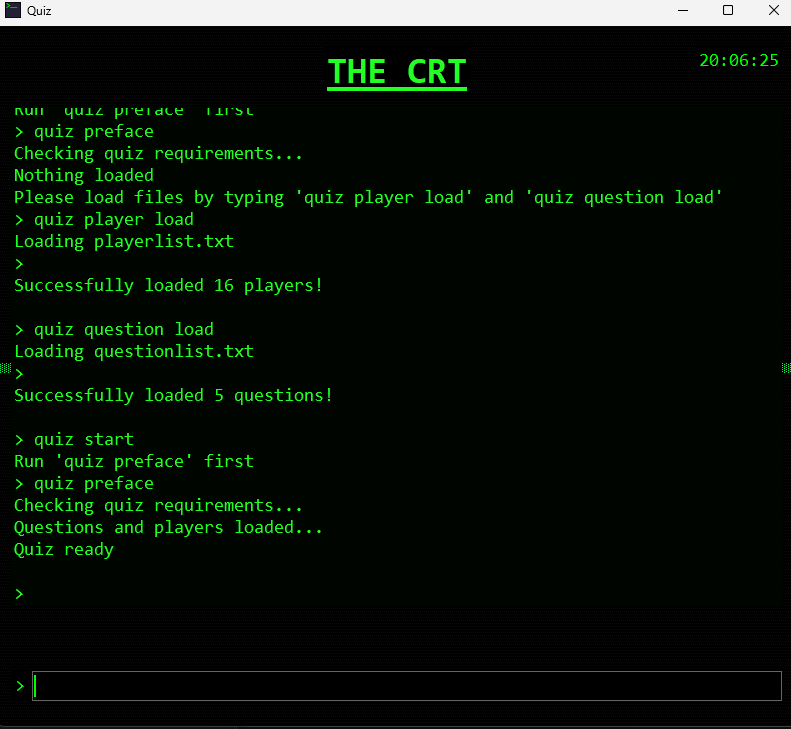

# Python-Quiz
A quiz app made in Python with TKinter where you can put in a list of player names and a list of questions, and be tested on them!

There are also a bunch of other features too! Such as _rickrolls_, a gamble feature and default player and quiz questions. 
This project is most likely going to be expanded upon, as the CRT style look is very nice and could do with extra updates!

That is basically it, if you want to try it out, then download the latest [Release](https://github.com/sadgituser/Python-Quiz/releases) from GitHub for your OS!

Ensure to use `chmod +x` if running the file on Linux to grant executing permissions!

Check out my GitHub [here](https://github.com/sadgituser) and my [Etsy Shop](https://theprintedcraftuk.etsy.com)!

[Hackclub Assets](https://hackclub.com/brand) & [Music Assets](https://pixabay.com/sound-effects/technology-noisy-computer-hum-34737/) & Terra Fox was snipped and edited from the [Terra](terra.hackclub.com) website!

Made for the [Hackclub Terra](https://terra.hackclub.com) project for [Hackclub](https://hackclub.com).

            
